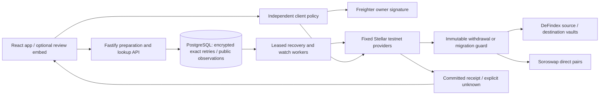

# Review and implementation plan after the rejected submission

Prepared 23 November 2026. The maintainer confirmed that these repository heads
are the rejected version. This document measures new work against those heads:

| Repository | Rejected commit |
| --- | --- |
| Frontend | `e168d9f` |
| Backend and SDK | `b09a7aa` |
| Contracts | `6462182` |

The rejection explanation has not been supplied. Findings below are engineering
observations, not an assertion about why Drips rejected the submission. Existing
features and October receipts must not be presented as developments from this
session. [RESUBMISSION.md](RESUBMISSION.md) will record completed changes and checks.

## Product and scope

Mierkhat composes an exact-share DeFindex withdrawal with direct Soroswap swaps,
so the owner receives one selected token with a signed minimum. A separate
immutable contract supports partial cross-asset vault migration, destination
share minima and residual-token refunds. The API prepares unsigned envelopes;
Freighter signs them; the SDK independently checks domain, identities, amounts,
fees, source sequence, validity and the exact nested authorization tree.

The enabled registry contains six withdrawal profiles across two strategy-free
vaults and two migration profiles. MKA, MKB and MKOUT are self-issued testnet
assets. These profiles demonstrate composition and recovery. They do not prove
compatibility with external yield strategies, independent partner adoption,
production liquidity, financial returns or independent security review.

## System map

| Area | Responsibilities and limitations |
| --- | --- |
| `App.tsx`, `wallet.ts`, `motion.ts` | Route selection, network-specific wallet identity, prompt lifecycle, metadata and reduced-motion navigation. Navigation is document based; React does not provide a router. |
| `PositionsWorkspace.tsx`, `Workspace.tsx` | One holding per vault, output-route selection, wallet setup, deposit, amount/target sizing and four-screen withdrawal review. Route changes invalidate quote and signature conditions. |
| `WithdrawalTools.tsx`, readiness and watch components | Public unsigned checks, conservative target planning and browser-capability alerts. Alerts are observations, never execution authorization. |
| `Migration.tsx`, migration review | Exact source shares, destination shares and refunds. Intermediary settlement is not a wallet payout. |
| `Activity.tsx`, recovery components | Browser-local hash pointers, terminal-state preservation, lookup, receipts and exact-byte recovery after unacknowledged admission. |
| Shared components / copy / CSS / assets | Local Archivo/Bitter, black/red/grey identity, light/dark appearances, native dialogs/details, typed shared copy and licensed assets. |
| `embed/` | Integrator-supplied wallet, preparation, lookup and submission callbacks; shares the SDK and copy archive. It must retain uncertain signed attempts just as the main app does. |
| SDK policy, codec and generated specs | Exact XDR/domain binding, restricted root/transfer authorization, canonical signed bytes, fee caps, owner signature and receipt verification. Generated ABIs remain derived from pinned WASM. |
| SDK live / planning / RPC / recovery | Real Horizon/Soroban reads, separate trustline/deposit/restore reviews, bounded planning, receipt lookup and hash-only durable browser records. |
| Backend API / store / workers | Strict HTTP inputs, fixed providers, encrypted retry bytes committed before sending, idempotency, leases, CAS terminal updates, receipt enrichment and retention. No user signing keys. |
| Contracts / compiled-WASM fixtures | Checked arithmetic, executable/profile pins before and after execution, exact share spend, donation preservation, exclusive deadlines, replay markers and full-state rollback. Migration additionally verifies proportional deposits and all refunds. |
| Build / CI / release / evidence | Frozen dependencies, compiled upstream WASM, reproducible checksums, security scans, immutable sibling pins, staged Vercel promotion and historical public Freighter/fault evidence. These are separate from an independent audit. |

## Findings and concrete work

| Priority | Finding in the rejected version | Planned change | Acceptance |
| --- | --- | --- | --- |
| P0 release | Vercel backend returns HTTP 402 `DEPLOYMENT_DISABLED`; maintainer confirms the hosting account is paused. | Verify locally; document the hosted-demo blocker and a reproducible startup path. Explain service outages in the UI without inventing balances. | Real local PostgreSQL/API health and live testnet reads. Public hosting remains a separately recorded blocker. |
| P1 | SDK `restorationKeys` includes withdrawal dependencies but omits migration destination vault and destination pairs/code. | Include every migration dependency with deduplication; independently check destination share decimals. | Tests inspect actual ledger-key XDR for both migration profiles and verify unrelated restore keys remain rejected. |
| P1 | Embed clears its signed attempt before admission; submission errors become `unknown` without a retry of the exact bytes. Stale reviews also lack a usable refresh path. | Retain attempt and pointer on uncertain admission; retry the same attempt, prevent replacement signing, provide review refresh and explicit confirmation. | Component-level callback tests: lost response, same hash/digest/bytes on retry, blocked replacement signing and stale-review refresh. |
| P1 | Retryable SDK read failures stop backend provider failover, although their error explicitly permits retry. | Try the next configured verified provider for retryable failures; keep deterministic policy failures terminal to that request. | Provider tests distinguish transient read failure, wrong network, stale ledger and nonretryable policy rejection. |
| P1 | Setup transaction lookup branches before respecting the requested environment. | Bind setup lookup to testnet and keep other environments isolated. | Actual PostgreSQL/API regression with a recorded setup hash queried as testnet and mainnet. |
| P2 | Workspace and position refreshes can overlap; late reads can publish old balances or invoke a parent after unmount. | Single-flight, generation-scoped refresh and an observable balance-read failure. | Delayed-read regression and route/account lifecycle checks; selected minimum and quote invalidation remain intact. |
| P2 | An empty position presents a disabled withdrawal progression and prose directing the user to deposit; setup is fragmented. | An explicit deposit action and a concise setup checklist; promote truthful testnet scope near the first action. | Disconnected and empty-account rendering; keyboard action changes to deposit; mobile and both themes fit. |
| P2 | Financial validation is mostly a generic notice; malformed address input receives number-oriented copy. | Specific inline amount/address errors, field associations, invalid state and valid-action gating; add recoverable hash-lookup errors. | Precision/overflow/balance/minimum tests; accessible field-error associations and hash lookup failure recovery. |
| P2 | Watch save uses a pre-request local-storage snapshot; simultaneous saves can lose capabilities. Actions lack busy feedback and initial alerts appear blank while loading. | Serialize same-origin save operations, merge and verify latest storage, guard stale results, explain the browser limit and show alert loading/action progress. | Concurrent storage/capability regression, delayed save with changed conditions, action recovery and rendered alert states. |
| P2 | Migration contract tests do not cover both exclusive deadline boundaries as explicitly as withdrawal tests. | Add compiled-WASM migration boundary/rollback tests. | Time equality and ledger equality both reject with unchanged ledger state; last-valid boundary succeeds. No executable/ABI change. |
| P2 | Resubmission scope is not anchored to the rejected commits; historical captures can look like current evidence. | Publish this plan, a component/system inventory, design conventions and a change ledger with real results. | Commit-based comparison in each repo; distinguish unit/browser/host tests, live reads, old signed evidence and external gates. |

## Implementation sequence

1. Commit the review plan in each repository before changing implementation.
2. Strengthen migration compiled-WASM boundary coverage and document results.
3. Fix SDK restoration/metadata; build and test it. Fix API/provider behavior in
   a separate backend step, including actual PostgreSQL integration coverage.
4. Repack the reviewed SDK once, update both frontend consumers and provenance,
   and verify the independently pinned release combination.
5. Improve shared feedback, first-use setup, financial validation and stale-read
   behavior while preserving the incumbent identity and withdrawal safeguards.
6. Fix alert persistence/interaction and the optional review embed in separate
   commits with meaningful regression coverage.
7. Run required checks, inspect rendered mobile/tablet/desktop light and dark
   surfaces, publish actual outcomes and update coordinated sibling pins.
8. Verify authors and committers are `dotmantissa <negativemantissa@gmail.com>`
   and no co-author trailers exist, then push completed work. Hosting recovery is
   excluded while the account remains paused.

Each implementation commit follows its relevant checks. No plan checkbox or
release claim should imply that unexecuted validation or deployment succeeded.

## Frontend direction

Refine the current system; preserve brand geometry, fonts and semantic palette.
Transaction screens prioritize the selected vault, amount, minimum, fee and next
action. Internal route IDs, raw envelopes and protocol mechanics stay in details.
Keep native controls and dialogs, visible focus, 44px touch controls, readable
field errors and useful motion alternatives. Test at 320, 768 and 1440 pixels in
both themes. Use the installed Impeccable audit/clarify/harden guidance and UI/UX
Pro Max's verified form-error guidance. Do not replace real service responses or
wallet state in the shipped application. Controlled component tests are labeled
as such and cannot establish genuine Freighter acceptance.

## Further development gates

| Work | Concrete prerequisite / deliverable |
| --- | --- |
| External useful-vault pilot | Identify an operator and exact vault, document the user problem and compare its current withdrawal/migration tooling. Obtain separately authorized partner feedback; this session sends no outreach. |
| Strategy-aware adapter | Specify each strategy executable, unwind/queue behavior, withdrawal fees, exact authorization and resource limits. Build a separate reviewed adapter with positive and rejecting WASM tests; never just remove the current strategy rejection. |
| Cold restoration | Observe genuine TTL expiry, record a separate signed restore and measure restored/cold resource headroom. Missing entries alone are not archive proof. |
| Service operability | Restore hosting, verify secrets/scheduler configuration and unattended watch cadence, add external uptime observation and a documented incident drill. Browser activity and daily Hobby cron do not prove minute-level unattended checks. |
| Independent review / mainnet | External review of composed contracts and client policies, production liquidity/pin evidence and a separate explicit mainnet release decision. Mainnet remains disabled. |

The hosted-service pause, issuer credentials, partner acceptance and independent
review are external dependencies. They must not be replaced with made-up data or
reported as finished software work.

## Finding added during local verification

The backend local launcher stopped PostgreSQL before the API's worker drain
finished. An awaited idempotent shutdown and safe idle-connection error handling
were added after documenting the finding in the backend plan. The completed
implementation and local restart results are recorded in RESUBMISSION.md.
